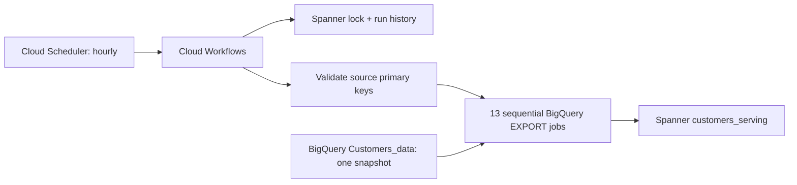

# Customers_data → Spanner

This pipeline uses [Google's native BigQuery export to Spanner](https://docs.cloud.google.com/bigquery/docs/export-to-spanner), Cloud Workflows, Cloud Scheduler and Terraform. These are Google-supported services; this custom implementation has no separate Google certification.

Live deployment results are in the [validation report](../../reports/customers-pipeline-2026-10-19.md).



The configuration targets project `premium-odyssey-508202-k9`, region `us-east1`, instance `graphkit-benchmark` and a separate database `customers_serving`. The schedule is `0 * * * *` in `America/Detroit`. Keys and renamed destination tables are explicit in [config.json](config.json), including composite monthly keys and source names containing hyphens. No source table is modified.

## Deploy and run

Use Application Default Credentials with permission to deploy the resources and grant their IAM roles. The Python environment needs this project's cloud dependencies. Run from the repository root:

```bash
PYTHONPATH=. .venv/bin/python scripts/customers_pipeline.py render
terraform -chdir=pipelines/customers_to_spanner init
terraform -chdir=pipelines/customers_to_spanner plan -var-file=generated/terraform.tfvars.json -out=pipeline.tfplan
terraform -chdir=pipelines/customers_to_spanner apply pipeline.tfplan
PYTHONPATH=. .venv/bin/python scripts/customers_pipeline.py run
PYTHONPATH=. .venv/bin/python scripts/customers_pipeline.py verify
```

Keep `schedule_paused` true for a new deployment until the initial load verifies; then set it false in config, render again, and plan/apply. Verification compares source snapshot row counts, all column null counts, numeric sums, string length sums and five ordered sample rows per table. It does not prove equality of every cell. Sample values are compared in memory and never written to the verification report.

New IAM grants can take several minutes to propagate. If the first execution fails to authenticate before acquiring its lock, retry after propagation. A newly created logging metric can also take time to become visible to Monitoring; if alert creation reports that the metric is missing, wait and rerun plan/apply.

Generated SQL, schema, workflow and Terraform variables contain metadata only. Runtime reports and Terraform state are ignored by git. Preserve Terraform state securely for future deployments; do not initialize a second independent state against the same resources. The destination database has deletion protection and Terraform `prevent_destroy`.

## Refresh behavior

- Each run records one BigQuery snapshot timestamp and validates all selected primary keys for nulls, duplicates and string length before exporting any table.
- Exports perform full-table **upserts** at LOW Spanner write priority. Rows deleted from BigQuery remain in Spanner. This is an hourly batch pipeline, without CDC or delete synchronization.
- Every source query uses the same timestamp. Destination tables refresh sequentially; readers can observe a partially refreshed batch. Cross-table atomic publication is not implemented.
- A Spanner primary-key lock prevents concurrent runs. Successful runs atomically record completion and release the lock. Failed or cancelled runs leave the lock for operator inspection.
- Schemas are explicit. Review schema/key changes and the Terraform plan before deploying them; incompatible changes do not migrate automatically.
- Jobs have a 30-minute requested timeout and 1 GiB per-job billing cap. A request timeout is not evidence that an export has stopped.

## Operations

Inspect the Cloud Workflows execution, Cloud Logging and `GraphkitPipelineRuns`. A log metric and alert policy create console incidents for workflow errors; notification channels are not configured. Runtime access is dataset read, project BigQuery job submission, instance metadata read and destination database access. Scheduler has project-level Workflows Invoker, the lowest supported resource level for that role.

BigQuery job IDs are `gk-EXECUTION_UUID-preflight` and `gk-EXECUTION_UUID-0` through `-12`. On failure, pause Scheduler first, inspect the failed step and check that the owning workflow and **all** its BigQuery jobs have terminated. Correct the cause, then delete only the matching row in `GraphkitPipelineLock` and rerun. Do not clear a lock while an export is active. Failed runs remain `STARTED` in run history and must be correlated with Workflows execution status. The workflow lock intentionally has no automatic expiry.

The project already has a BigQuery Enterprise reservation; native exports require Enterprise or Enterprise Plus capacity. This deployment creates no reservation or paid Spanner instance. Workflows, Scheduler, storage and BigQuery jobs can incur charges. The existing Spanner free-trial instance expires on **2027-01-17**; move to an approved long-lived instance before then for continued operation.

This pipeline copies business data. Graph proposals, developer review, semantic embeddings and agent serving remain separate steps in the graphkit workflow. Pipeline control tables are excluded from Spanner graph discovery.

References: [native export prerequisites and limits](https://docs.cloud.google.com/bigquery/docs/export-to-spanner), [graph reverse ETL and upserts](https://docs.cloud.google.com/spanner/docs/graph/reverse-etl), [Workflows access control](https://docs.cloud.google.com/workflows/docs/access-control).
